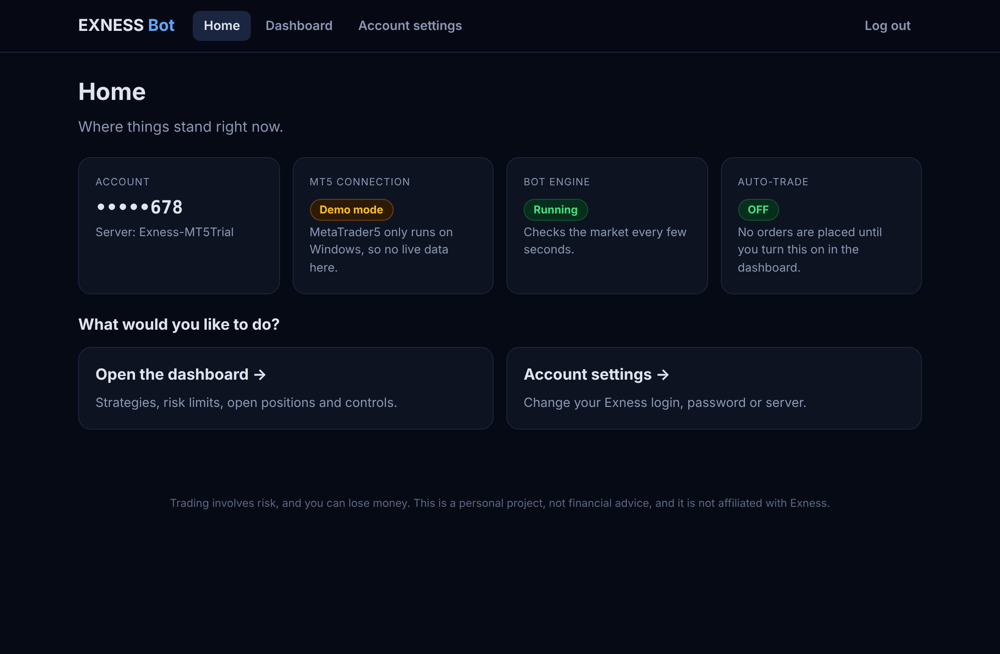
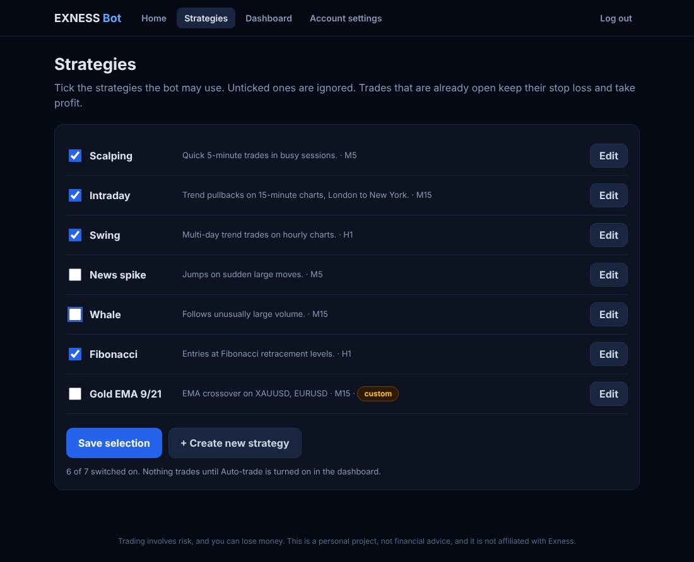
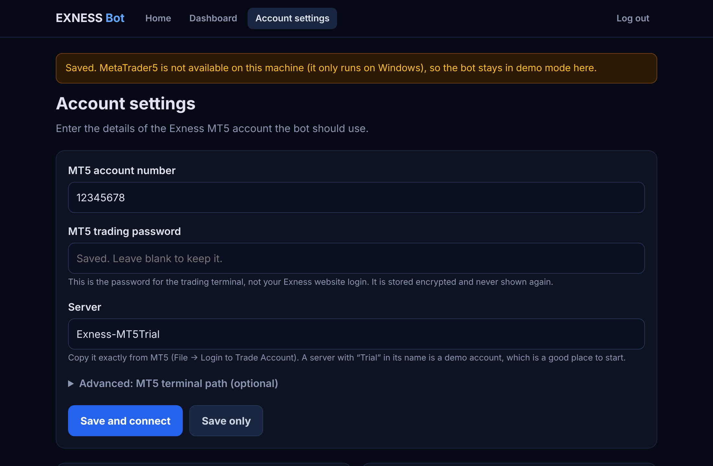
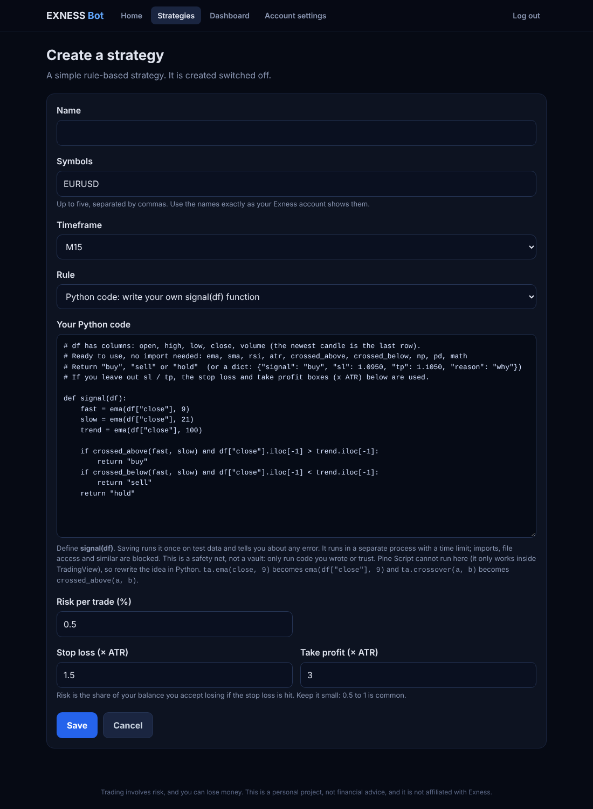
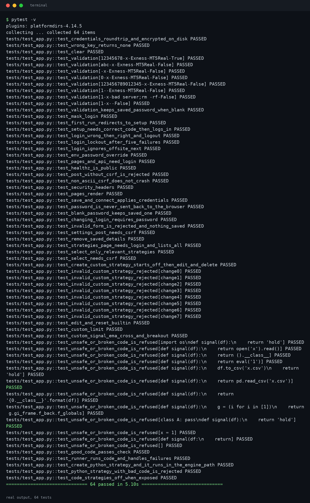
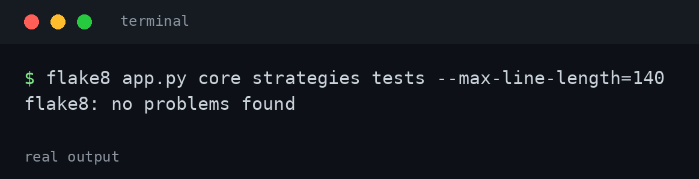

<div align="center">

# Exness MT5 Trading Bot

**A multi-strategy trading bot for Exness MetaTrader 5, with a simple password-protected web interface.**

   -informational)

**Author:** LingarajH · [LinkedIn](https://www.linkedin.com/in/lingaraj-h-a3a7b3404/) · [GitHub](https://github.com/LingarajH-011)

</div>

> ⚠️ **Risk notice.** Trading leveraged products can lose money quickly. This is a personal learning project, **not financial advice**, and is **not affiliated with Exness**. Test on a **demo account** first. Auto-trade is **OFF by default**.

## Why this project

The original bot was configured by editing files by hand. This version adds a web interface so everything is done in the browser: enter your Exness account, pick which strategies to trade, and write your own.

## Screenshots

| Home | Strategies |
|---|---|
|  |  |
| **Account settings** | **Python strategy editor** |
|  |  |

## Features

| Page | What you can do |
|---|---|
| **Home** | See account, MT5 connection, bot engine and auto-trade status at a glance |
| **Account settings** | Enter Exness login, trading password and server in a form. Saved **encrypted** (Fernet), password never shown again |
| **Strategies** | Tick the strategies to trade, edit risk / stop loss / take profit, create your own, delete or reset |
| **Dashboard** | Live signals, risk limits, open positions, Start / Stop / Close-all |

- **Six built-in strategies:** scalping, intraday, swing, news spike, whale, Fibonacci.
- **Your own strategies:** a simple rule (EMA crossover, RSI reversal, breakout) or **your own Python code**.
- **Safety:** login required, CSRF protection, lockout after 5 wrong passwords, security headers, risk guardian with daily loss limits, auto-trade off by default.

## Quick start (Windows)

MetaTrader 5 only runs on Windows, so live trading needs Windows. Linux/macOS run in demo mode.

**1. Install**
- [MetaTrader 5 from Exness](https://www.exness.com), log in to it once
- Python 3.10 or newer

**2. Get the code and install packages**
```powershell
git clone https://github.com/LingarajH-011/exness-trading-bot.git
cd exness-trading-bot
python -m venv .venv
.venv\Scripts\activate
python -m pip install -r requirements.txt
```

**3. Start the app**
```powershell
python app.py
```
The terminal prints a one-time **setup code**. Open <http://127.0.0.1:5000>, enter the code and choose a dashboard password (10+ characters).

**4. Connect your account**
Go to **Account settings**, enter your MT5 account number, **trading** password and server, then press **Save and connect**. A demo server has `Trial` in its name, for example `Exness-MT5Trial11` (copy it exactly from MT5). Home should say **Connected**.

**5. Choose strategies and start**
Open **Strategies**, tick the ones you want, press **Save selection**. In the **Dashboard** press Start. Turn **Auto-trade** on only when you are ready (demo account first).

## Create your own strategy

On **Strategies → + Create new strategy** pick a rule, or choose **Python code** and define `signal(df)`:

```python
def signal(df):
    fast = ema(df["close"], 9)
    slow = ema(df["close"], 21)
    trend = ema(df["close"], 100)

    if crossed_above(fast, slow) and df["close"].iloc[-1] > trend.iloc[-1]:
        return "buy"
    if crossed_below(fast, slow) and df["close"].iloc[-1] < trend.iloc[-1]:
        return "sell"
    return "hold"
```

- `df` has `open, high, low, close, volume`; the newest candle is the last row.
- Ready to use without importing: `ema, sma, rsi, atr, crossed_above, crossed_below, np, pd, math`.
- Return `"buy"`, `"sell"`, `"hold"`, or `{"signal": "buy", "sl": 1.0950, "tp": 1.1050, "reason": "why"}`. Without `sl`/`tp` the ATR multiples from the form are used.
- Saving test-runs your code on sample data and shows errors immediately. New strategies start **switched off**.
- Code runs in a **separate process with a time limit**; imports, file access and `eval` are blocked. This is a safety net, **not a hard sandbox**: only run code you trust.
- Pine Script cannot run here (it only works inside TradingView). Rewrite it in Python, e.g. `ta.ema(close, 9)` becomes `ema(df["close"], 9)`.

## Tests and output

```powershell
python -m pip install -r requirements-dev.txt
pytest -q
flake8 app.py core strategies tests --max-line-length=140
```





GitHub Actions runs the same lint and tests on every push, and checks that no secret files are tracked.

## Configuration

Optional environment variables (see `.env.example`):

| Variable | Purpose | Default |
|---|---|---|
| `FLASK_HOST` / `PORT` | Where the web app listens | `127.0.0.1` / `5000` |
| `DASHBOARD_PASSWORD` | Fixed dashboard password instead of first-run setup | unset |
| `BOT_SECRET_KEY` | Fernet key for saved account details | auto-generated in `data/` |
| `ALLOW_CODE_STRATEGIES` | `1`/`0` forces Python code strategies on/off | on only for localhost |
| `COOKIE_SECURE` | `1` when served over HTTPS | `0` |
| `TRUST_PROXY` | `1` behind nginx / a load balancer | `0` |
| `BOT_DATA_DIR` | Where settings are stored | `./data` |

## Project layout

```
app.py                 Flask web app (pages, forms, API)
core/                  bot engine, MT5 connector, risk guardian, credential store, code runner
strategies/            six built-in strategies + custom (rule and Python) strategies
templates/, static/    the web pages
tests/                 64 automated tests
docs/                  AWS guide, publishing guide, screenshots, output images
```

## Deploying to AWS

MetaTrader 5 needs Windows. A **Linux** server can host the dashboard in demo mode only; a **Windows** server can trade but costs money. Never expose the app directly to the internet. See [docs/DEPLOY-AWS.md](docs/DEPLOY-AWS.md).

## Publishing your own copy

Step-by-step GitHub instructions, including how to avoid committing secrets: [docs/RUN-AND-PUBLISH.md](docs/RUN-AND-PUBLISH.md).

## Security notes

- Never commit `.env`, `data/`, `logs/`, `*.enc` or `.secret_key` (all in `.gitignore`).
- Use a **new** password if your trading password has ever been in a file or screenshot.
- Keep the app on `127.0.0.1`, or behind HTTPS with access limited to your own IP.

## Limitations

- At most 6 positions open at once, one per strategy and direction.
- The `mode` value in the config is only a label; real orders need **Auto-trade** on and the risk guardian's approval.
- Strategies are not guaranteed profitable. Backtest and demo-test before trusting any of them.

## License

For personal and educational use. Provided as is, without warranty.
