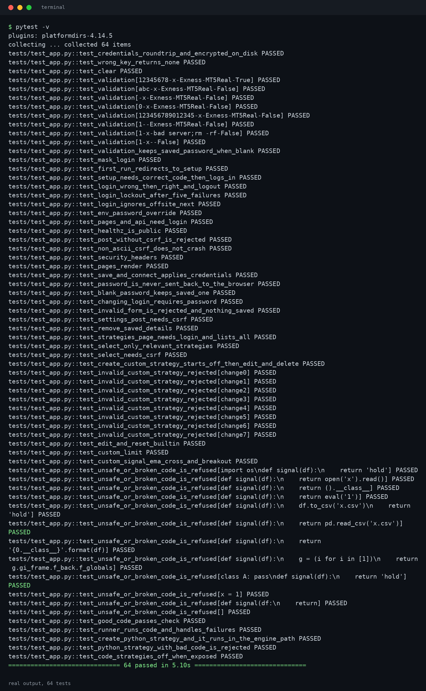
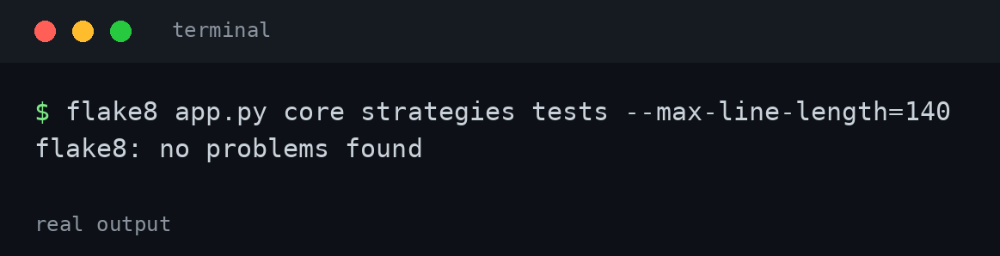
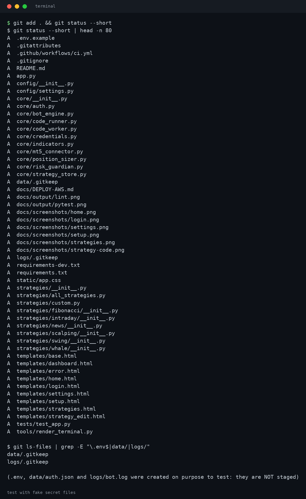

# Run it, test it, publish it (Windows + VS Code)

Author: LingarajH · GitHub: [LingarajH-011](https://github.com/LingarajH-011)

## Part 1: Run and test on your PC

1. Open the project folder in VS Code (File → Open Folder). Open a terminal with Ctrl+`.
2. One-time setup:
   ```powershell
   python -m venv .venv
   .venv\Scripts\activate
   python -m pip install -r requirements-dev.txt
   ```
   If activate is blocked: `Set-ExecutionPolicy -Scope CurrentUser RemoteSigned`, answer Y.
3. Run the tests. Expected: `64 passed`.
   ```powershell
   pytest -q
   ```
   
4. Run the lint check. Expected: no problems.
   ```powershell
   flake8 app.py core strategies tests --max-line-length=140
   ```
   
5. Start the app and open <http://127.0.0.1:5000>:
   ```powershell
   python app.py
   ```
   Enter the **setup code** printed in the terminal, choose a dashboard password (10+ characters).
6. **Account settings**: account number, trading password, server. For a demo account the server name contains `Trial` (copy it exactly from MT5, e.g. `Exness-MT5Trial11`). Press *Save and connect*. Home should say **Connected**.
7. **Strategies**: tick the ones to trade, press *Save selection*. Use *Edit* or *+ Create new strategy* (rules or Python code).
8. **Dashboard**: press Start. Keep **Auto-trade OFF** until you have watched the signals on a demo account.

## Part 2: Publish to GitHub

Do this once, from the project folder in the VS Code terminal.

1. **Check your git identity** uses the GitHub no-reply address (stops GH007 "private email" push errors):
   ```powershell
   git config --global user.name "LingarajH"
   git config --global user.email "195525591+LingarajH-011@users.noreply.github.com"
   ```
2. **Create the repository** on GitHub: github.com → New repository → name `exness-trading-bot`, Public, *do not* add README/.gitignore/licence → Create.
3. **Initialise and check nothing secret is staged:**
   ```powershell
   git init
   git add .
   git status --short
   git ls-files | findstr /R "\.env$ data\\ logs\\"
   ```
   The last command may only list `data/.gitkeep` and `logs/.gitkeep`. If you see `.env`, `auth.json`, `.enc` or a `.log` file, run `git rm --cached <file>` before continuing.
   
   (This image was made with fake secret files to prove `.gitignore` keeps them out.)
4. **Commit and push:**
   ```powershell
   git commit -m "Exness MT5 trading bot with web interface"
   git branch -M main
   git remote add origin https://github.com/LingarajH-011/exness-trading-bot.git
   git push -u origin main
   ```
   A browser window may ask you to sign in to GitHub the first time.
5. **Check on GitHub:** the Actions tab should show the CI run turn green (lint, tests, secret check). Open the repo page and check the README screenshots show.
6. **Make it look good:** add a description, topics (`python`, `flask`, `metatrader5`, `trading-bot`), and pin the repo on your profile.

### If something goes wrong
| Message | Fix |
|---|---|
| `GH007: push would publish a private email address` | Step 1, then `git commit --amend --reset-author --no-edit` and push again |
| `remote origin already exists` | `git remote set-url origin https://github.com/LingarajH-011/exness-trading-bot.git` |
| `rejected ... fetch first` | The GitHub repo is not empty. `git pull origin main --allow-unrelated-histories`, then push |
| A secret was committed | **Change the password first.** Then remove it from history; deleting the file in a new commit is not enough |
| CI red on flake8 | Run the lint command from Part 1 and fix the lines it lists |

### Never commit
`.env`, anything in `data/` or `logs/`, `*.enc`, `.secret_key`, screenshots that show your account number or password.
